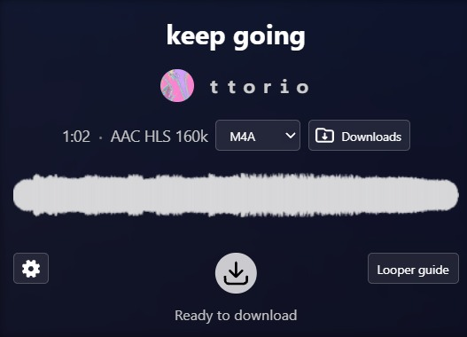
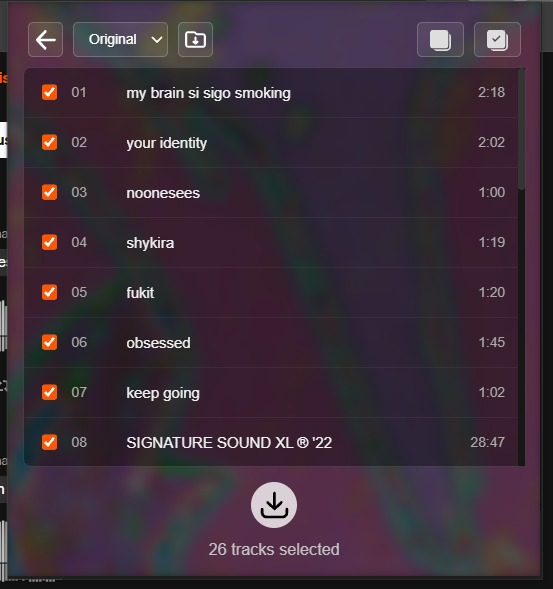
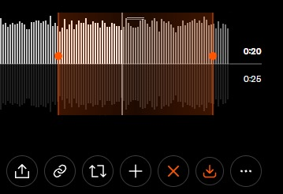
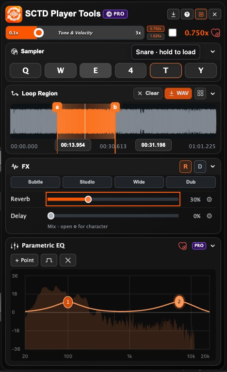

# 🎵 SoundCloud Downloader

> Download SoundCloud tracks, playlists, and likes ~ right from your browser. One extension, one click.

  
  

## Current source checkout — 2026.10.5

This README describes the source checkout, not proof that this build is available on Chrome Web Store. A Lemon Squeezy Test Mode purchase, automatic Pro activation, and exit from the seven-day trial were confirmed on September 24, 2026. Restore, additional profiles, refund/revocation, Live setup, and the production release remain open. See the [documentation status and remaining work](docs/ESTADO-ACTUAL-20260924.md).

**Highlights:**
- **Inline download button** ~ download tracks directly from SoundCloud's action bar (Like/Repost/Share) without opening the popup
- **Tempo-panel download button** ~ download the track currently playing from SoundCloud's persistent player at the active speed and pitch setting
- **Playback speed control** ~ choose `0.1x` to `3x` from the persistent player, in `0.025x` steps, with optional **Keep Tone**
- **Tempo-aware loop export** ~ the downloaded A-B WAV uses the current player speed and either natural pitch or Signalsmith-preserved pitch
- **Playlists, sets & albums** ~ download collections as numbered files in a folder
- **International filenames** ~ preserves Cyrillic, accented, CJK, and emoji titles while keeping paths safe on Windows, macOS, and Linux
- **Remembered download folder** ~ use the native folder picker once, then change the destination beside the quality and amount selectors whenever needed
- **Likes** ~ your own (`/you/likes`) or any user's public likes page
- **Background bulk downloads** ~ close the popup or switch tabs; downloads keep running
- **Sequential bulk audio processing** ~ one track build at a time, with bounded source/render budgets (no giant ZIP in RAM); device memory validation remains part of release QA
- **Configurable batch size** ~ choose how many tracks to grab: `10`, `25`, `50`, `100`, `150`, `200`, `300`, or **All**
- **No login required** for most public tracks (OAuth fallback when needed)
- **Modern AAC HLS streaming** support ~ SoundCloud's current format, handled automatically
- **SPA-friendly** ~ switch tracks, playlists, or pages without reloading SoundCloud
- **Polished UI** ~ loading spinner, clear error states, download progress, pause/cancel, badge, and notifications
- **Real Audio** ~ when an artist enables downloads on SoundCloud, the extension can use the uploaded file instead of the streamed transcode, subject to the selected format and access policy; WAV requires Pro

If you used an older version and ran into bugs ~ stale track data, blank screens, login-only downloads ~ this update was built to fix exactly that. 🎉

---

## ✨ Features

### Single tracks
- Track title, artwork, and artist info (with clickable profile link)
- Duration and stream format (e.g. `AAC HLS 160k`)
- Waveform visualization
- One-click download ~ works on public tracks without signing in
- **Inline download button** on the track page action bar (next to Like/Repost/Share) ~ same download flow, no popup needed
- **Master download button** inside the persistent player's tempo panel ~ downloads the complete track currently playing at the active speed and pitch setting, even when no loop is selected
- **Experimental A-B looper** on individual track pages ~ drag the A/B markers over the waveform and repeat the selected section without starting paused audio
- **Inline download button** on playlist/set and likes pages ~ starts a background bulk job for the full collection
- **User profile downloads** ~ open `soundcloud.com/{user}/tracks`, choose from every public upload, and download the selection as one background job

### Record your performance

Open **Record** below Parametric EQ in Player Tools. **Rec** captures the final mix of the playing track or loop, sampler pads, piano voices, and effects after EQ. The amplitude display shows live audio before a take and the captured sample afterwards; zoom, scroll, or click to seek, then preview or download a stereo 48 kHz / 16-bit WAV. Recording continues when the panel is collapsed or hidden and stops automatically at five minutes. Download your take before starting another or reloading the page; takes are kept in memory only.

### Playlists, sets & albums
- Open any `soundcloud.com/{user}/sets/{name}` page
- See the collection title, artist, total track count, and waveform preview (first track)
- Enter how many tracks to download, or choose All or Select
- Download everything as numbered files in `Downloads/{Playlist Name}/`

### Likes
- **Your likes:** `soundcloud.com/you/likes` (requires being logged in)
- **Anyone's likes:** `soundcloud.com/{username}/likes`
- Same folder-based bulk download flow as playlists

### Bulk download controls
- Enter any amount from 0 up to the collection size; 0 pauses the action until an amount is entered
- The amount menu offers **All** and **Select** for choosing individual tracks
- Warning prompt before large downloads (200+ tracks)
- **Pause / resume / cancel** while a bulk job is running
- **Extension badge** shows progress (e.g. `30/500`)
- **Desktop notification** when the job finishes (even if the popup was closed)

### Reliability & UX
- Deferred metadata loading ~ fast popup open, full resolution only when you hit download
- Loading overlay with retry on timeout
- Clear error screen when you're not on a supported page
- Download progress: `Track 3/50 ~ Downloading 12/48 parts...`
- SPA navigation detection ~ no more stale track data when browsing SoundCloud
- Bulk jobs are coordinated by the service worker with an offscreen document for audio processing; memory on modest hardware still needs device-specific validation

### Screenshots

#### Choose tracks from a playlist

#### Create an A-B loop and download the selected range

#### Open the looper from the SoundCloud action bar

### Promotional images

These assets may show earlier UI; capture the final candidate before updating the Store listing.

---

## 🚀 How It Works

### Download a single track
1. Go to any SoundCloud **track** page
2. Open the speedometer in the persistent player and click its white **master download icon**, use the **inline download button** in the action bar (next to Like/Repost/Share), **or** click the extension icon and use the popup download button
3. Wait for the track info to load (popup only)
4. Hit download ~ the file saves to your browser's default download folder

Use the compact **Folder** button beside the format selector to open the system folder picker. The chosen directory is remembered and used as the final destination; create any new folder directly in that picker. If no folder is selected, the browser's default Downloads directory is used.

### Change playback speed

1. Play any SoundCloud track
2. Press the speedometer in the player controls
3. Move the slider from `0.1x` to `3x` in `0.025x` steps
4. Enable **Keep Tone** to keep the original pitch while changing speed

Double-click the slider to return to `1x`. The selected speed and pitch mode are remembered locally.

### Loop part of a track

1. Open an individual track page and load or play the track
2. Press the loop button immediately before **More actions**
3. Drag A and B on the waveform; use the arrow keys for 100 ms adjustments or Shift + arrow for 1 second
4. Scroll **up** over the waveform to zoom toward the cursor, or scroll **down** to zoom back out. This makes it easy to place a precise A-B range even on a long track.
5. Choose the player speed and **Preserve Pitch** mode you want
6. Press **Download loop** to render the selected A-B range as a WAV file with those settings
7. Press the cross or `Escape` to remove the temporary loop

Player Tools starts a 7-day trial for the current Chrome profile on first eligible use, with up to 20 new A–B loops. The server preserves that profile's window and usage, but the trial is not advertised as reinstall-proof because the extension deliberately requires no account and uses no browser fingerprinting. Premium effects, parametric EQ, Likes Explorer, saving loops to sampler pads and sample piano mode remain available for all seven days independently of loop usage, then require Pro. Reverb, Echo, basic sampler pads and normal track/collection downloads remain free. The last granted loop can finish its current session; WAV, processed track/loop exports and precise loop editing require Pro. Pro is a lifetime purchase for two activated Chrome profiles and uses a signed 30-day offline receipt. Online revocation checks run every six hours and when returning to SoundCloud or opening the popup; temporary network failures preserve a still-valid receipt.

### Download a playlist, likes, or user uploads
1. Go to a **playlist/set**, **likes**, or `soundcloud.com/{user}/tracks` page
2. Click the **inline download button** in the action bar, **or** click the extension icon and use the popup
3. Choose how many tracks to download from the dropdown next to the track count (popup only)
4. Hit the download button
5. Files appear directly in the chosen folder as they complete. Without a chosen folder, they appear in `Downloads/{Collection Name}/`
6. You may **close the popup or tab** ~ the download continues in the background

On user track pages, the in-page **Download tracks** button opens the selector with every upload selected by default.

The selected folder is the final destination; the extension does not add another playlist/profile subfolder beneath it.

---

## 🎨 User Interface

One popup, two modes ~ same look, same feel:

| Track page | Playlist / Likes page |
|---|---|
| Title · artist · duration · format | Title · artist · editable amount / All / Select |
| Waveform | Waveform (first track) |
| Inline button + popup download | Inline button (full list) or popup with editable amount |

Dark blurred artwork background, SoundCloud-orange accents, spinner states, and status text that actually tells you what's going on.

---

## 🛠️ Technical notes

- **Manifest V3** Chrome extension
- Streams resolved via SoundCloud's `api-v2` (public `client_id` + optional OAuth cookie)
- HLS segments fetched and assembled client-side; output as `.m4a` / `.mp3` depending on source
- Bulk downloads use `chrome.downloads` for the default Downloads location or the File System Access API for a user-selected folder, plus an offscreen document; bulk audio processing is sequential (`MAX_IN_FLIGHT = 1`), with explicit byte/render budgets
- Bulk jobs survive popup/tab close; per-track state ensures recovery after service worker restarts
- Job, track and direct-download operation state is stored durably in IndexedDB and reconciled after service-worker/browser restarts
- Pause stops new tracks; in-flight downloads still finish and save
- Bulk jobs enumerate pages durably in the worker; stream URLs are refreshed per track if they expire. Manual **Select** currently loads the complete selectable list before showing virtualized rows; it is not a paginated data view
- The A-B looper keeps its timing rules in a DOM-free module so a future precise audio/download adapter can reuse the same range
- SoundCloud's detached `Audio` player is captured by a minimal MAIN-world bridge; the looper UI only exchanges player state and seek commands with it
- Loop WAV processing runs in the extension's offscreen document. Signalsmith/WASM is loaded only for preserved-pitch exports, so it never takes ownership of SoundCloud's live audio graph

---

## 🔧 Troubleshooting

**Extension doesn't recognize the track page**
- Make sure you're on a track URL like `soundcloud.com/artist/track-name` (not the home feed or search)
- If you navigated from likes or another page and the popup stays blank, wait a few seconds or click **Retry** — a full page refresh is rarely needed now

**Download fails or shows an error**
- **Ad blockers** can block requests to `*.sndcdn.com`. Disable your ad blocker for `soundcloud.com` and try again
- **Enable popups and redirects** for `soundcloud.com` in your browser settings (required for some download flows)
- Sign in to SoundCloud if the track is private or requires login

**Audio quality**
- Available formats and quality depend on the source SoundCloud provides for that track and session; the extension does not guarantee a bitrate or lossless audio
- When the artist has enabled downloads, the extension can use the **original uploaded file**, subject to format and access policy. WAV requires Pro; Auto can fall back to an available MP3 source
- Otherwise, files are saved from an available streaming transcode; converting a stream to WAV does not recover original quality

---

## 💡 Feedback

Something not working? A feature you'd love to see next?
- Open a Pull Request or email [it@vpugliese.online](mailto:it@vpugliese.online) ~ I'd love to hear from you.

---

## ⚠️ Disclaimer

Please respect artists' rights and SoundCloud's terms of service when using this extension. Download only content you have the right to save for personal use.

---

*Made with ❤️ for music lovers ~ and for myself, obviously.*
