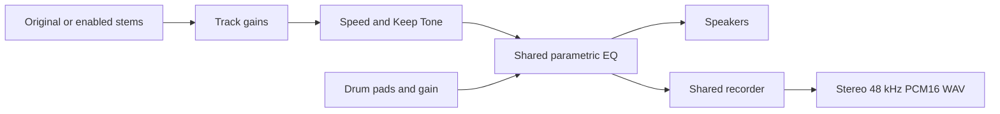

# EQ and recorder in Looper and Stems

Both pages mount `SCParametricEQUI` and `SCRecordUI` directly. EQ gestures,
filtering, spectrum, clipping, recording, preview and WAV export each retain
one implementation in `parametric-eq*.js` and `record-*.js`.

The shared interface is the effects object consumed by those modules:
`snapshot`, `setEqualizer`, `analyseEqualizer`, `getPlaybackContext` and
`observeOutput`. The last method publishes a post-EQ output and returns an
unsubscribe function. It must never create a second audible route.

There are two real adapters at this seam:

- `audio-effects-core.js` follows SoundCloud playback contexts and media changes.
- `local-audio-output.mjs` owns the EQ graph for the single context supplied by
  the Stems page. The page retains ownership of the context's lifetime.

Stems supplies explicit icon and worklet URLs; the Looper retains its existing
extension-asset defaults. Each page mounts once. Stems disposes its mounts,
output graph and context on exit. Playback, mute and volume remain owned by
Stems; neither shared UI needs to know what a stem is.

This keeps locality for EQ/recording changes and leverage for both callers.
The deletion test favors reusing the existing deep modules: copying them would
spread the same complexity across both pages. A combined mounting wrapper
would only forward options, so there is no additional module for that.

Stems saves EQ settings with a separation. Individual stem downloads remain
unaltered 44.1 kHz float WAVs. The recorder captures the audible output in real
time until Stop, including repeated A-B playback, track changes and EQ edits;
it exports a separate take. Recorded preview does not feed the mix again.

Verification crosses the same interface through the rendered controls:
`stems-ui.browser-test.cjs` inspects downloaded PCM for isolated vocals,
all-OFF silence and EQ attenuation, and checks desktop/mobile layout.
`stem-presets.browser-test.cjs` verifies EQ restoration. Existing EQ and
recorder browser suites cover SoundCloud routing and Looper interactions.

Completion checks (2026-10-05): Stems UI and downloaded PCM, preset EQ
restoration and real Keep Tone playback, and the loaded-extension recorder
smoke test all passed. The previous integration run also passed the 61 local
verifications, EQ browser suite, recorder/Looper browser suite, local-audio
import suite and seven Stems tests (including the package allow-list).
No release ZIP was generated or published as part of this change.
